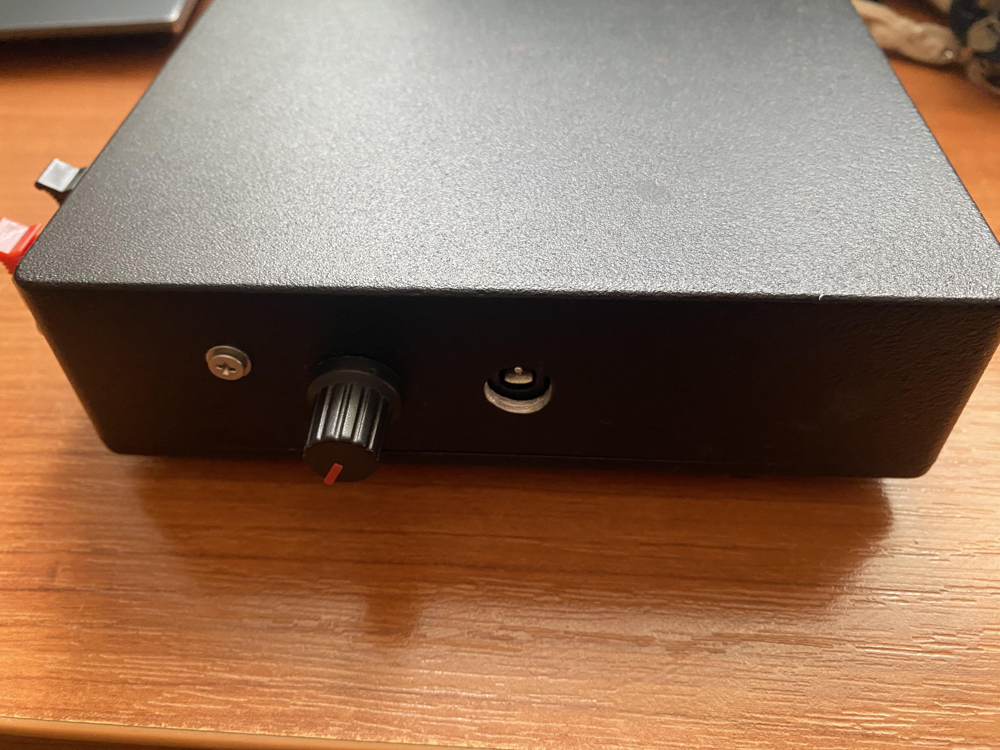
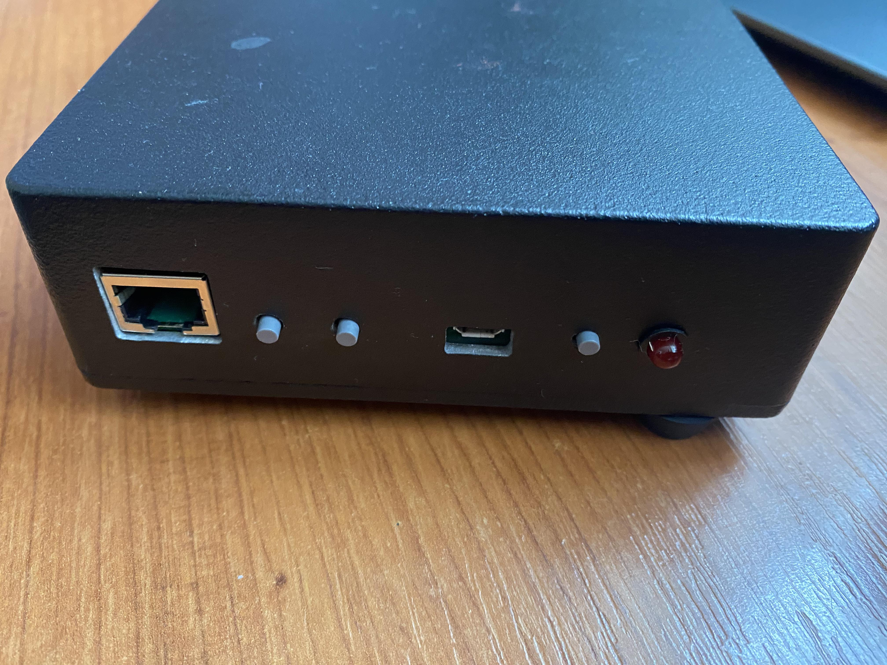
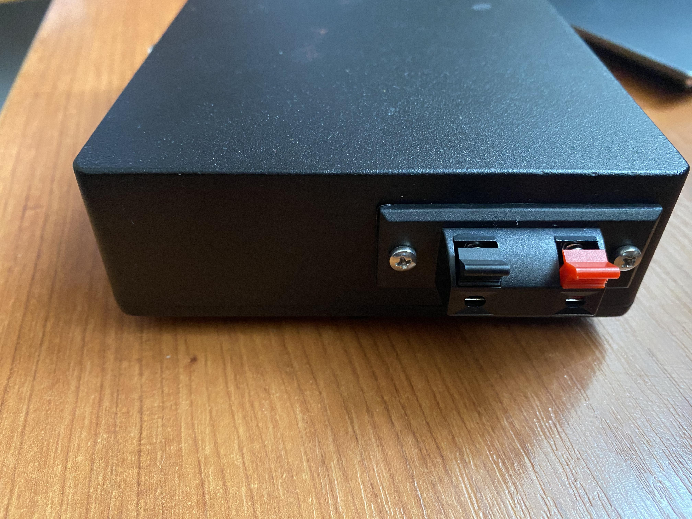
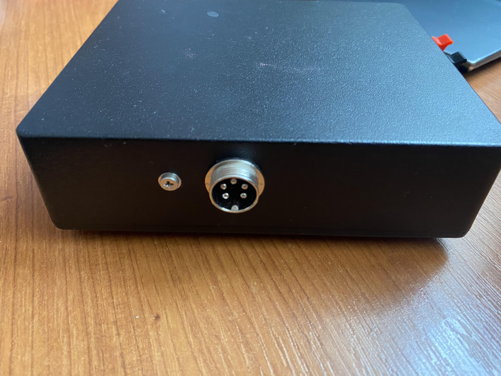
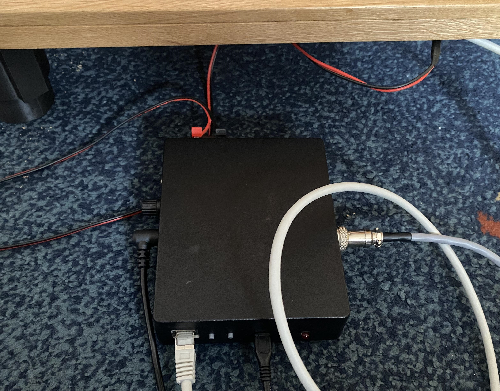
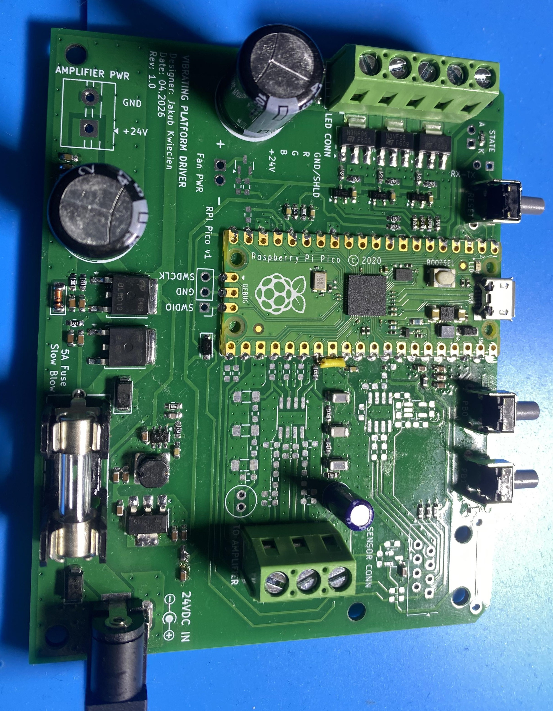
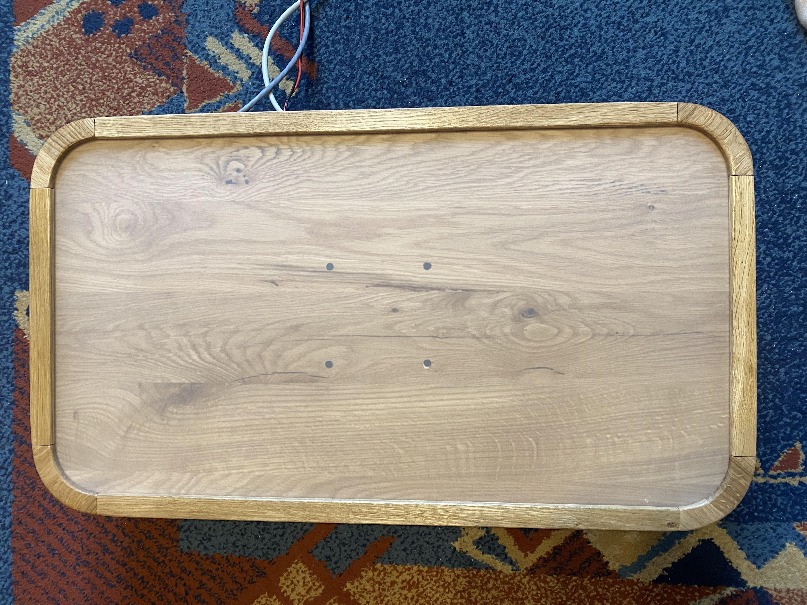
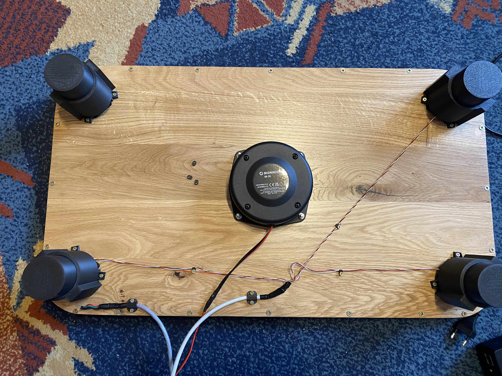

# Audio-Reactive Vibrating Platform

An end-to-end engineering project involving the design and construction of an interactive, vibrating platform. The system synchronizes physical vibrations and dynamic RGB LED lighting with an audio stream in real-time. Built from the ground including mechanical design, custom 3D-printed parts, hardware driver design and bare-metal multi-core firmware.

## System Features and Capabilities

- **Vibrations Synchronized With Music:** The platform operates as a digital loudspeaker crossover and an amplifier.
- **Dynamic Visual Effects:** Features an RGB LED lighting system with 4 distinct lighting effects.
- **Smart Activation:** Integrated tensometer sensors built into the platform's feet to detect human presence, automatically managing the device's visual effects.

## Technical Architecture

The heart of the system is based on the RP2040 microcontroller, utilizing a highly optimized, bare-metal C implementation. 

- **USB Audio Interface:** The controller enumerates as a standard USB Audio Output device on the host computer, directly receiving a 48 kHz digital audio stream.
- **Digital Crossover & Power Stage:** The system acts as a digital crossover. It filters the incoming audio signal and routes low frequencies to a power amplifier, which drives the physical haptic transducer (bass shaker).
- **Multi-Core Processing:**
  - **Core 0 (Audio & DSP):** Dedicated strictly to hard real-time tasks. It handles USB audio reception and applies a highly optimized, fixed-point DSP filtering algorithm and PWM audio generation.
  - **Core 1 (UI & Visuals):** Manages soft real-time tasks, including sensor data processing, button debouncing, and calculating the LED envelope and gamma corrections.

## Scope of Work

This project represents a complete product development cycle, requiring integration across multiple engineering disciplines:

- **Software Engineering:** Development of a multi-core, bare-metal C application utilizing lock-free data structures (ring buffers), hardware spinlocks, and custom DSP algorithms without relying on an RTOS.
- **Hardware Design and Integration:** Design and assembly of the main controller board, electrical wiring, power management (handling transient loads from LEDs and amplifiers), and enclosure preparation.
- **Mechanical & 3D Design:** 3D modeling of the entire platform structure.
- **Custom Sensor Implementation:** Designing, modeling, and 3D printing custom mechanical feet equipped with tensometers (strain gauges) to reliably detect weight/presence.
- **Final Assembly:** Complete mechanical and electrical assembly, tuning, and calibration of the final device.

## Device Prototype and Presentation

<table>
	<tr>
		<td width="50%"></td>
		<td width="50%"></td>
	</tr>
</table>

<table>
	<tr>
		<td width="50%"></td>
		<td width="50%"></td>
	</tr>
</table>

<table>
	<tr>
		<td width="50%"></td>
		<td width="50%"></td>
	</tr>
	<tr>
		<td align="center">Wiring</td>
		<td align="center">Hardware during assembly</td>
	</tr>
</table>

	

	

## Short Presentation

https://github.com/user-attachments/assets/c167e0bf-ab05-4b39-b470-8a2112a0e94a
